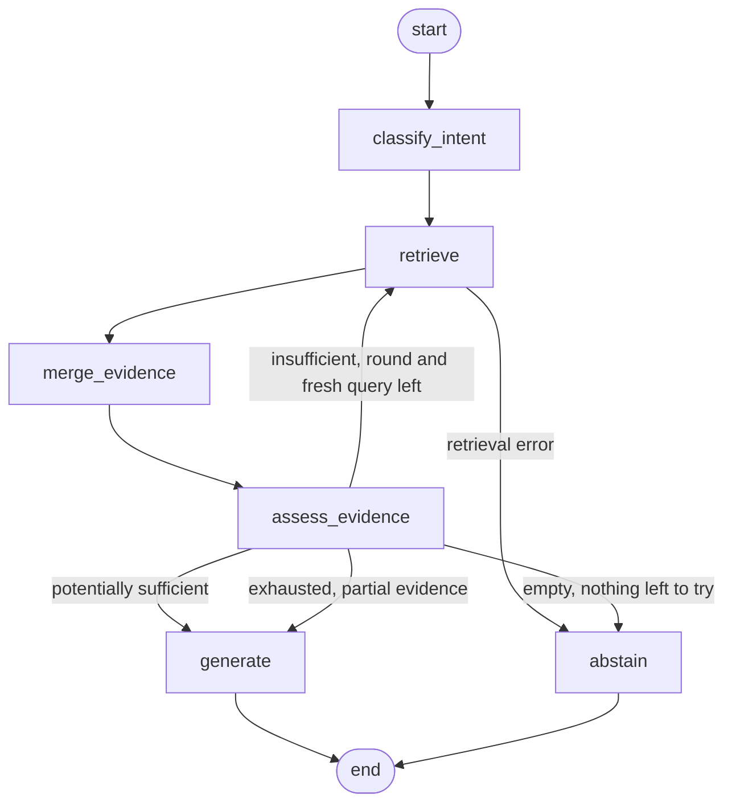

# Agentic RAG workflow (Milestone 8)

A LangGraph workflow that sits **beside** the baseline RAG path. It adds an explicit loop that
retrieves in a few bounded rounds, checks what it has found, and then either answers through the
existing guarded RAG service or abstains. The baseline (`python -m copilot.rag`, `RagService.answer`)
is unchanged and does not import this package.

> **No quality claim is made here.** Nothing in this milestone measures whether the agentic
> workflow answers better than baseline RAG. The offline tests use a fake retriever and a fake
> model; they establish that the *control flow* is correct and safe, not that a real model gives
> better answers. Measuring quality is the job of the evaluation milestones.

## Three systems, kept distinct

| | Plain LLM | Baseline RAG | Agentic RAG (this milestone) |
|---|---|---|---|
| Repository evidence | none | one retrieval, fixed top-k | up to N retrieval rounds, accumulated |
| Query | the question | the question | the question, then refined queries built from the question's own words |
| Decides when to stop | n/a | n/a | deterministic evidence heuristic + budgets |
| Intent-specific behaviour | none | none | top-k, per-file cap, ordering, refinement order |
| Citations | none | from the context that was sent | from the context that was sent (same code) |
| Prompt, model call, secret gate | plain prompt | RAG prompt `rag-v1`, guarded | the same RAG prompt `rag-v1`, same guarded client |
| Code | `answer_plain` | `RagService.answer` | `AgentWorkflow.run` -> `RagService.answer_from_evidence` |

## Graph



`python -m copilot.agents graph` prints LangGraph's own rendering of the compiled graph, so the
diagram can be regenerated and compared with the code.

### Nodes

| Node | Responsibility | Uses an LLM? |
|---|---|---|
| `classify_intent` | Route the question (ordered regexes), extract key terms and identifiers, build the retrieval plan | no |
| `retrieve` | One search with the current query and the plan's `top_k`, via the existing `Retriever` (embedding model + FAISS) | no |
| `merge_evidence` | Add the round's results to the accumulated evidence (dedupe, caps) | no |
| `assess_evidence` | Lexical sufficiency check, decide refine / generate / abstain, pick the next query | no |
| `generate` | Order the evidence for the prompt and call `RagService.answer_from_evidence` | **the only node that can** |
| `abstain` | Terminal node when there is nothing to answer from | no |

### Edges

Fixed: `start -> classify_intent -> retrieve`, `merge_evidence -> assess_evidence`,
`generate -> end`, `abstain -> end`. Conditional (plain functions of the state, unit-tested):

* `route_after_retrieval`: failure -> `abstain`, otherwise `merge_evidence`.
* `route_after_assessment`: `potentially_sufficient` -> `generate`; `insufficient_refinable` ->
  `retrieve`; `empty` -> `retrieve` if a round and a fresh query remain, else `abstain`;
  `exhausted` -> `generate` (with the partial evidence).

## State

`AgentState` (`src/copilot/agents/state.py`) is a `TypedDict`. Every node returns only the keys it
changes; `trace` has an `operator.add` reducer so nodes append events.

| Field | Meaning |
|---|---|
| `query` | the validated user question, never modified |
| `config` | `AgentConfig` (limits, below) |
| `intent`, `decision` | the router's output and the rule that fired |
| `plan` | `RetrievalPlan` for the intent |
| `terms` | the question's content words |
| `current_query`, `current_kind` | the next/last search text and where it came from |
| `asked_queries` | normalised forms of every query issued (repeat detection) |
| `round`, `max_rounds` | attempt count and budget (the first retrieval is round 1) |
| `results` | the latest round's `RetrievalResult`s |
| `evidence` | accumulated evidence across rounds |
| `new_accepted` | chunks the latest round added |
| `assessment` | `Assessment` (outcome, reason, term coverage, missing terms, stop reason) |
| `termination` | why the run ended (`TerminationReason`) |
| `answer`, `citations` | the `RagAnswer` and its `Citation`s |
| `abstention_reason`, `failure` | why nothing was generated; a typed `FailureInfo` |
| `trace` | the structured trace |

Existing types are reused: `RetrievalResult`, `Citation`, `RagAnswer`, `GenerationInfo`.

## Intent routing (`intent.py`)

Deterministic and LLM-free. Intents are tested in this precedence order and the first with a
matching rule wins:

1. `debugging`: problem words ("crash", "fails", "bug", "traceback", "unexpected"), a reported
   error ("getting an error"), an error class (`KeyError`), an HTTP 4xx/5xx status, or "why does X
   return/raise ...".
2. `symbol_lookup`: "where is/are ...", "where ... defined/used/configured ...", "which files
   implement ...", "find/locate ... function/class ...", "who calls/uses ...".
3. `architecture`: "architecture", "overview", "high-level", "project/repository structure", a flow
   between components, "how is the repo organised".
4. `code_explain`: "explain", "walk me through", "describe", "how does X work", "what does X do",
   "purpose of".
5. `general`: everything else.

Why this order: debugging and locational questions often contain explanation words ("explain why
it crashes"), and the narrower reading should win; `architecture` beats `code_explain` so that
"Explain the architecture of this repository" is an architecture question. `IntentDecision.matched`
lists every intent that had a matching rule, so overlaps are visible in the trace.

Ambiguity falls back to `general`: a question with no recognised shape (`general.fallback`) or with
no content word and no identifier at all, such as "What does this function do?"
(`general.too-vague`).

`debugging` currently only selects a retrieval strategy. The evidence-based debugging assistant
(error-log handling, hypothesis separation) is a later milestone and is not built here.

### What the intent changes

| Intent | Chunks per round | Per-file cap | Order in the prompt | Refinement order |
|---|---|---|---|---|
| `symbol_lookup` | base | none | chunks whose symbol/path mention a question symbol or term first | symbol, missing terms, focused terms |
| `code_explain` | base | none | discovery order | missing terms, focused terms, symbol |
| `architecture` | candidate pool (default 50) | 2 | distinct files first, then the rest | missing terms, focused terms |
| `debugging` | base | none | discovery order | missing terms, symbol, focused terms |
| `general` | base | none | discovery order | missing terms, focused terms |

Assessment also differs: `symbol_lookup` needs the named identifier to appear in the evidence;
`architecture` needs at least `COPILOT_AGENT_ARCHITECTURE_MIN_FILES` distinct files.

## Refinement (`planning.py`)

Round 1 always searches the user's exact question. A later round uses one of:

* **missing terms**: the question terms that the evidence does not mention yet (plus the first
  identifier of the question), so the next search targets what is absent;
* **focused terms**: the question's content words without the question boilerplate;
* **symbol**: the identifiers that appear in the question.

Each is followed by one fixed intent hint word ("definition", "implementation", "overview
structure", "error handling"). Refined queries are built **only from words in the question** plus
that hint. Nothing is taken from retrieved text, so repository content cannot steer the search, and
no file path or symbol that the user did not write can appear in a query. A candidate whose set of
words equals an earlier query's is skipped; if every candidate repeats, the loop stops
(`no_new_query`).

## Evidence assessment (`assessment.py`)

A **lexical heuristic, not a relevance judge.** All of these must hold for
`potentially_sufficient`:

* the fraction of question terms found (after crude suffix stripping) in the accumulated evidence's
  text, file paths and symbol names is at least `COPILOT_AGENT_MIN_TERM_COVERAGE` (default 0.5);
* `symbol_lookup`: a named identifier appears in the evidence;
* `architecture`: enough distinct files.

Outcomes: `empty`, `potentially_sufficient`, `insufficient_refinable`, `exhausted`.

Limits, stated plainly: it cannot tell whether the evidence is *correct* or *answers* the question;
common words pass trivially; synonyms the code never uses fail even when the right chunk was
retrieved; the stemmer is crude. There is deliberately **no similarity-score threshold**: cosine
scores are not calibrated and not comparable across queries, so any universal cutoff would be
arbitrary. The thresholds are configuration, not tuned constants, and have not been tuned on data.

## Termination

The loop ends when the first of these holds (recorded as `termination` and in the trace):

| Reason | Meaning |
|---|---|
| `evidence_potentially_sufficient` | the heuristic passed |
| `max_rounds_reached` | the round budget is used (default 3 including the first, max 5) |
| `no_new_evidence` | a refined round added no chunk that was not already known |
| `no_new_query` | every refinement would repeat an earlier query |
| `no_evidence` | nothing was retrieved and nothing more can be tried |
| `retrieval_failed` / `generation_failed` | a typed failure, kept as data |

When the heuristic was *not* satisfied but some evidence exists, generation still proceeds on that
partial evidence and the CLI prints a warning; the baseline RAG prompt itself tells the model to
state insufficient evidence. Only an empty evidence set (or a context that cannot fit any chunk)
abstains without a model call.

## Budgets and candidate selection (Milestone 8.1)

Three budgets are separate, applied at three points, and reported separately in the trace:

| Budget | Setting | Applied | Default |
|---|---|---|---|
| **Candidate**: chunks requested from the retriever per round | baseline `COPILOT_RETRIEVAL_TOP_K` (5); for architecture `COPILOT_AGENT_ARCHITECTURE_CANDIDATES` | `retrieve` | 5; architecture 50 |
| **Evidence**: chunks kept across rounds, and per file | `COPILOT_AGENT_MAX_EVIDENCE_CHUNKS`; per-file cap (architecture: 2) | `merge_evidence` | 15; 2 |
| **Context**: tokens of evidence in the prompt | baseline `COPILOT_RAG_CONTEXT_MAX_TOKENS` | `build_context` | 6000 |

The architecture candidate pool of 50 is an **engineering default** (it equals the retriever's
maximum), not an empirically optimal value, and nothing here has been tuned.

**Root cause fixed in 8.1.** Milestone 8 requested only twice the baseline top-k (10) for
architecture questions and applied the per-file cap to those 10. On the frozen snapshot all 10 came
from `docs/ARCHITECTURE_PLAN.md`: 2 were kept, 8 were discarded, round 2 found nothing new, and the
run ended with 2 chunks from 1 file. The candidate budget and the per-file cap were coupled, so a
dominant file starved the selection.

**Selection now.** Each round's candidates are put in a deterministic order `(rank, position,
chunk_id)`. Architecture selection then makes two passes: pass 1 takes the best candidate of each
file not yet represented in the evidence; pass 2 fills the remaining capacity with the best remaining
candidates, honouring the per-file cap. Relevance order decides which chunk and which file comes
first; diversity decides only that a new file beats a second chunk of an already represented file.
Existing evidence is never evicted or reordered, duplicates (by `chunk_id` or by file and line span)
are rejected, and only chunks the retriever returned are ever selected: diversity is never invented.
Other intents use the unchanged sequential rule (no pool, no per-file cap).

A chunk selected only to add a file may have a low rank (in the real-index run below, retrieval
rank 46 and 21). Its rank and score are reported honestly in the citation; whether such chunks help
is not measured.

**What the trace distinguishes** (counts only):

* candidate starvation: `retrieve` shows `top_k` (requested) versus `retrieved` (returned) and
  `candidate_files`; `merge_evidence` shows `rejected_per_file_cap`;
* evidence-budget pressure: `rejected_capacity`;
* repeated evidence: `rejected_duplicate`;
* context truncation: `generate` shows `context_chunks` versus `evidence_total` and
  `context_dropped_budget`.

## Citation and provenance semantics

`Citation.rank` and `Citation.score` keep their baseline meaning: the **retrieval rank and cosine
score of the retrieval that supplied the chunk**. They are not rewritten by the agent. (Milestone 8
rewrote `rank` to 1..n to carry the evidence order; that conflated rank with order, and it is
removed.) The agent's order is passed to the context builder with `preserve_order=True`
(`build_context` and `RagService.answer_from_evidence`; the default is the baseline's rank sort).

| Concept | Where it lives |
|---|---|
| original retrieval rank | `Citation.rank`, `SourceProvenance.retrieval_rank` (rank within that round's query) |
| retrieval round | `SourceProvenance.retrieval_round` |
| similarity score | `Citation.score`, `SourceProvenance.score` (cosine of that round's query) |
| selected evidence order | `SourceProvenance.selection_order` |
| final prompt source number | `Citation.source_number` (`Source n`), also `SourceProvenance.source_number` |

`AgentResult.provenance` has one entry per citation, joined by `chunk_id`. A chunk found in several
rounds takes its provenance from its **first** retrieval; later occurrences are rejected as
duplicates and their rank and score are ignored. Ranks and scores from different (refined) queries
are not comparable and are never used to order or compare evidence across rounds: cross-round order
is discovery order.

Evidence is preserved across rounds and never evicted; the prompt is still bounded by the baseline's
`COPILOT_RAG_CONTEXT_MAX_TOKENS`.

## Generation and security

* Generation calls `RagService.answer_from_evidence` (the second half of the baseline's `answer`):
  same context builder, same prompts and `rag-v1` version, same limits, same
  `GuardedLLMClient`. The exact question and every included chunk are secret-scanned, then the exact
  outbound request is scanned again; a finding raises before any provider call. There is no flag
  that disables it.
* Citations are the baseline's: built from retrieval metadata of the chunks that entered the prompt,
  never parsed from model text. A `[Source 9]` label the model invents is reported as unknown, not
  turned into a citation.
* No generation on abstention. Provider errors keep their type (`LLMRateLimitError`, ...), message
  and limits and are returned in `AgentResult.failure`.
* Retrieved text is untrusted data. It is matched lexically and placed in the delimited context;
  it never selects an intent, a query, a node or a tool.
* Read-only: the package imports nothing that runs commands, writes files, or reaches the network;
  the graph has no tool node. The only outward call is the guarded model call. (Both properties are
  asserted by tests that scan the package source.)

## Trace

Every node appends a `TraceEvent`: node, round, intent, duration, safe query metadata (kind,
character count, word count, a 12-hex hash, never the text), candidates requested / returned and
their distinct files, chunks accepted and rejected (duplicate, per-file cap, evidence capacity),
distinct evidence files, final context chunk count and chunks dropped for the token budget,
assessment outcome, term coverage, routing decision, termination reason, generation status.
It never contains the question, refined queries, source text, prompts, model output, provider error
bodies, keys, or scanner findings. Example (a scripted offline scenario, three rounds):

```
classify_intent: round=0 intent=code_explain query_terms=5 top_k=5 rule_id=code_explain.explain-words
retrieve: round=1 query_kind=original query_chars=68 query_sha256_12=5f30f9fb7573 top_k=5 retrieved=1
merge_evidence: round=1 retrieved=1 new_accepted=1 evidence_total=1
assess_evidence: round=1 assessment=insufficient_refinable term_coverage=0.2 missing_terms=4 routing=refine note=term_coverage_below_threshold
retrieve: round=2 query_kind=missing_terms query_chars=46 query_sha256_12=46a254644184 top_k=5 retrieved=1
merge_evidence: round=2 retrieved=1 new_accepted=1 evidence_total=2
assess_evidence: round=2 assessment=insufficient_refinable term_coverage=0.4 missing_terms=3 routing=refine
retrieve: round=3 query_kind=missing_terms query_chars=38 query_sha256_12=96c5a99217de top_k=5 retrieved=1
merge_evidence: round=3 retrieved=1 new_accepted=1 evidence_total=3
assess_evidence: round=3 assessment=potentially_sufficient term_coverage=0.6 routing=generate termination_reason=evidence_potentially_sufficient
generate: round=3 evidence_total=3 generation_status=answered
```

## Configuration

Agent settings are separate from the baseline's (`.env.example`):

| Variable | Default | Range | Meaning |
|---|---|---|---|
| `COPILOT_AGENT_MAX_RETRIEVAL_ROUNDS` | 3 | 1-5 | rounds including the first |
| `COPILOT_AGENT_MAX_EVIDENCE_CHUNKS` | 15 | 1-50 | accumulated evidence cap |
| `COPILOT_AGENT_MIN_TERM_COVERAGE` | 0.5 | 0-1 | heuristic threshold |
| `COPILOT_AGENT_ARCHITECTURE_MIN_FILES` | 2 | 1-10 | distinct files for architecture questions |
| `COPILOT_AGENT_ARCHITECTURE_CANDIDATES` | 50 | 1-50 | candidate pool per round for architecture (engineering default, not tuned) |

The per-round chunk count starts from the baseline's `COPILOT_RETRIEVAL_TOP_K`.

## CLI

```
python -m copilot.agents ask INDEX_DIR --repo PATH "question" [--max-rounds N] [--trace] [--fake-llm] [--ignore-dir D]
python -m copilot.agents graph
```

`--fake-llm` replaces only the model with a deterministic stand-in (no network, no key, no model
id); retrieval still uses the real local index and embedding model. Exit status: 0 answered or
abstained, 1 refused by the secret gate, 2 any other error. Without `--fake-llm` it behaves like
`copilot.rag ask` (configured Gemini model, secret gate).

Windows PowerShell, offline, against the frozen evaluation snapshot and its index (read-only: the
workflow never writes to either):

```powershell
cd C:\Users\divya\agentic-rag-code-copilot
uv run python -m copilot.agents ask data\indexes\4aaeab9c650ab76c --repo data\snapshots\a282ec471ebf1387cb4feafcfe732ad24a431c7a\tree --ignore-dir data --ignore-dir tests --ignore-dir submission --fake-llm --trace "Where is the secret scanner gate implemented?"
uv run python -m copilot.agents ask data\indexes\4aaeab9c650ab76c --repo data\snapshots\a282ec471ebf1387cb4feafcfe732ad24a431c7a\tree --ignore-dir data --ignore-dir tests --ignore-dir submission --fake-llm --max-rounds 2 "Explain the architecture of this repository"
uv run python -m copilot.agents graph
```

Use the same `--ignore-dir` flags as the index build (the evaluation commands in
`docs/evaluation.md`); the retriever refuses a repository that no longer matches the index.

## Testing

`tests/unit/test_agent_*.py` (offline, no model, no network): routing for every intent, overlap and
ambiguity; intent-specific planning, ordering and assessment; real multi-round iteration with a
scripted retriever; budget, repeated-query and no-new-evidence stops; dedupe; abstention; generation
through the guarded client with the baseline's exact prompt; citations from the supplied evidence;
provider failures; secret-gate blocking with zero provider calls; injection-like retrieved text;
trace contents; the read-only property; CLI argument validation, Windows-style paths and exit codes;
baseline and evaluation-artifact compatibility. **These tests do not establish real-model quality.**

## Limitations

* The sufficiency heuristic is lexical; see above. It was not tuned or evaluated on real data.
* Refinement can only re-use the question's own words; it cannot reformulate semantically (that
  would need a model, which this milestone deliberately avoids in the control path).
* Intent rules are English regexes written by hand; unusual phrasings fall back to `general`.
* Refinement uses more retrieval calls, so latency grows with rounds; embedding cost is local.
* There is no agentic-vs-baseline accuracy result. Do not cite one.
* The candidate pool cannot create diversity that the ranking does not contain. On the frozen
  snapshot the 50 nearest chunks for "Explain the architecture of this repository" come from only
  two files, both documentation (`docs/ARCHITECTURE_PLAN.md`, `README.md`): the question is
  semantically closest to prose, not to source modules. The "at least 2 files" check is then
  satisfied by two documents, which says nothing about whether source code was found. Expect a
  documentation-heavy architecture context until a retrieval change (not part of this milestone)
  addresses it.
* Distinct-file preference can select a low-ranked chunk (rank 46 in that run) to add a file; its
  relevance is unmeasured.
* The evidence-based debugging assistant, structure-aware chunking and the chunking experiment are
  later milestones.
