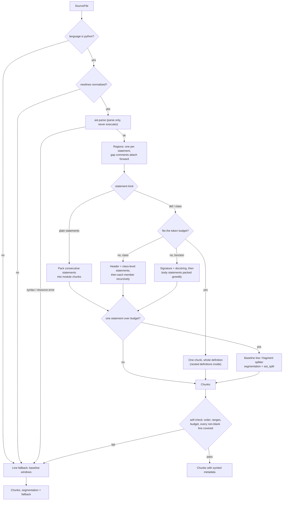

# Chunking: baseline (Milestone 3) and structure-aware (Milestone 9)

Two strategies implement the same `Chunker` interface and are selected by name:

| | Strategy A `"line"` (default) | Strategy B `"ast"` |
|---|---|---|
| Milestone | 3 | 9 |
| Cuts | overlapping line windows, any file | Python definition/statement boundaries; everything else by Strategy A's windows |
| Knows about code | no (a true structure-blind control) | Python only, through the standard-library `ast` |
| Symbol metadata | none | `symbol_name`, `qualified_name`, `parent_class` |
| Overlap | yes (`chunk_overlap_lines`) | none between structural chunks |

The first half of this document specifies the baseline (unchanged by Milestone 9). The second half,
[Structure-aware chunking](#structure-aware-chunking-milestone-9-strategy-b), specifies Strategy B.
**Neither half says anything about which strategy retrieves better: that is the Milestone 10
experiment.** Selecting a strategy never falls back to the other one silently.

## Usage

```python
from copilot.chunking import chunk_repository, create_chunker
from copilot.ingestion import ingest_repository

ingestion = ingest_repository("path/to/repo")
result = chunk_repository(ingestion, create_chunker())  # strategy/params come from Settings
print(result.stats.summary())
```

```bash
uv run python -m copilot.chunking path/to/repo --samples 5   # statistics + chunk metadata, never contents
```

## Algorithm

* **Primary boundary - configurable line windows.** A window is `chunk_size_lines` (default 60)
  whole lines. Consecutive windows share `chunk_overlap_lines` (default 10) lines.
* **Safety boundary - estimated token cap.** If a window would exceed `chunk_max_tokens`
  (default 512 *estimated* tokens) it is shortened to the longest run of whole lines that fits.
  The cap only counts tokens; it never inspects programming-language or document structure.
* **Progress rule.** The next window starts `overlap` lines before the previous end but always
  after the previous start, and a window is emitted only if it adds at least one not-yet-covered
  line (so a shortened window cannot cause a cascade of near-duplicates). When shortening leaves
  no room, the effective overlap is smaller than configured; around a fragmented line (below)
  there is no overlap.
* **Over-long single line.** A physical line that alone exceeds the cap cannot be shortened by
  removing lines, so it is split deterministically into contiguous **fragments** on token
  boundaries (see the fragment contract). Without this the safety limit could not be enforced.
* **Blank text.** Whitespace-only windows are dropped; an empty file yields no chunks.

Windows are built from per-line token counts (the estimate is additive over lines) in linear time.
The token estimator (`utils/tokens.py`) counts ASCII word runs and every other non-space
character individually. It is a **provisional heuristic**: it needs no tokenizer download, is
conservative for non-ASCII text, and will be checked against the real embedding tokenizer in
Milestone 4. The cap is therefore a safety budget, not an exact guarantee.

### Markdown

Markdown is windowed by lines like any other file. `chunking/markdown_sections.py` keeps a
heading-aware splitter (ATX headings, fenced-code aware) as a **standalone utility for a future
structure-aware strategy**. Nothing in the baseline imports it; a test asserts that importing the
baseline does not load the module and that Markdown boundaries are identical to those of the same
text in a `.py` file.

## Line semantics

Lines are those of the newline-normalised text (ingestion converts CRLF/CR to LF), numbered
**1-based and inclusive**: `start_line`/`end_line` name real lines. Text is split on `"\n"` only,
and a terminal newline *terminates* the last line rather than starting a new one, so it never
creates a phantom citation line:

| `content` | Physical lines | Chunks `(start, end, content)` |
|---|---|---|
| `""` | none | none |
| `"abc"` | `["abc"]` | `(1, 1, "abc")` |
| `"abc\n"` | `["abc"]` | `(1, 1, "abc")` |
| `"abc\n\n"` | `["abc", ""]` | `(1, 2, "abc\n")` (line 2 is a real blank line) |
| `"\n"` | `[""]` | none (whitespace only) |

For a chunk of whole lines, `content == "\n".join(lines[start_line-1:end_line])`.

## Long-line fragment contract

A fragment is a piece of one physical line, not a new source line.

* Every fragment keeps that line's own number: `start_line == end_line == <physical line>`.
* Fragments carry `fragment_index` (0-based) and `fragment_count`; both are `None` for chunks of
  whole lines (`Chunk.is_fragment`).
* Cuts are at estimated-token boundaries, so `"".join(fragment contents) == the original line`.
* Each fragment has at most `chunk_max_tokens` estimated tokens.
* A fragmented line is never also part of a whole-line window (it is excluded from windows).

## Chunk-ID contract

`chunk_id` is the first 16 hex characters (64 bits) of the SHA-256 of a canonical JSON string:

```text
text    = json.dumps(payload, ensure_ascii=True, sort_keys=True, separators=(",", ":"))
chunk_id = sha256(text.encode("utf-8")).hexdigest()[:16]

payload = [ "chunk-id/1",          # CHUNK_ID_SCHEMA
            repository_name,       # repository identity
            file_path,             # canonical repository-relative POSIX path
            source_sha256,         # SourceFile.sha256: SHA-256 of the file's raw bytes
            strategy,              # e.g. "line"
            strategy_version,      # algorithm version of the strategy, e.g. 1
            params,                # chunker parameter mapping (sorted by key)
            unit ]                 # position, see below

unit    = ["w", start_line, end_line]        # window of whole lines
        | ["f", line, fragment_index]        # fragment of one physical line
```

For the line strategy `params = {"max_tokens", "overlap_lines", "size_lines"}`. JSON quoting makes
the serialisation unambiguous: no path or name can forge a field boundary. Nothing random is used.
`source_sha256` already represents the content, so the chunk text is not hashed again (chunk
content is available separately as `Chunk.content_sha256`).

**What changes a chunk's identity:** the repository name, the file path, *any* edit to the file
(all chunk ids of that file change), the strategy name, the strategy `version`, any chunker
parameter, and the chunk's own position. Nothing else.

| Property | How it is met |
|---|---|
| A. Same source + strategy + config gives the same ids | pure function of the inputs above |
| B. Different repositories with the same path and content do not collide | `repository_name` is hashed |
| C. Changed source never reuses stale identity | `source_sha256` is hashed |
| D. Different strategies cannot collide | `strategy` (and its `version`) are hashed |
| E. Different relevant configuration cannot reuse ids | all `params` and the strategy `version` are hashed |
| F. Fragments have unique deterministic ids | `["f", line, fragment_index]` |

Consequences and limits:

* Because `source_sha256` covers the whole file, an edit anywhere changes **every** chunk id of that
  file, including chunks whose text did not change. Use `Chunk.content_sha256` to detect unchanged
  chunk text across versions.
* `repository_name` is the identity used. Two *different* repositories that share a directory name
  must be ingested with distinct `repository_name`s (an `ingest_repository` argument); otherwise
  they can only collide when path and bytes are identical, i.e. when the chunks are identical too.
* `strategy_version` must be bumped whenever the windowing algorithm **or the token estimator**
  changes output for the same input and parameters.
* 64 bits gives a collision probability of roughly n^2 / 2^65 (about 3e-8 for a million chunks);
  `chunk_repository` raises `ChunkingError` if a duplicate id is ever produced.
* `CHUNK_ID_SCHEMA` versions the formula itself. A golden-value test locks the current formula.

## Chunk metadata

`chunk_id`, `repository_name`, `file_path`, `source_sha256`, `language`, `chunk_type`
(`line_window` for the baseline), `chunking_strategy`, `chunking_version`, `chunk_index`,
`start_line`, `end_line`, `content`, `content_sha256`, `token_estimate`, `fragment_index`,
`fragment_count`, the symbol fields `symbol_name`, `qualified_name`, `parent_class` and
`segmentation`. The last four are always `None` for the baseline; Strategy B fills them (Milestone 9
added `segmentation` and the chunk types `module`, `function`, `method`, `class`).

Tested invariants: line ranges stay within the file; content equals the source slice (or a
fragment of one line); no chunk exceeds the token cap; ids are unique; no whole-line window is
contained in another; every non-blank line is covered by at least one chunk.

## Statistics contract

`ChunkStats` separates physical lines from chunk line slots:

| Field | Meaning |
|---|---|
| `source_lines_total` | physical lines in the chunked files |
| `unique_source_lines_represented` | distinct `(file, line)` covered by any chunk; a fragmented line counts **once** |
| `overlap_duplicated_lines` | lines counted more than once because of overlap: whole-line chunk line slots minus the distinct lines they cover. Fragments never contribute |
| `chunk_count` | `whole_line_chunk_count + fragment_chunk_count` |
| `fragment_chunk_count` / `fragmented_line_count` | fragment chunks / distinct lines that were fragmented |
| tokens mean/median/p95/max | over chunks, estimated |

## Known limitations

* Structure-blind by design: a function or Markdown section can be split across windows (a test
  documents this); that is what Strategy B is compared against.
* With the default 512-token cap, dense text reaches the cap before 60 lines, so effective windows
  are often shorter than 60 lines and overlap is reduced. The defaults are unmeasured starting
  points. On this repository at commit `9e3586f`: 220 chunks, median 490 / p95 511 estimated
  tokens, 5343 source lines represented, 1491 lines duplicated by overlap, and 89% of non-final
  chunks shortened by the cap (see `docs/embeddings.md` for the cap sweep).
* The token estimator is a heuristic. Measured against the real Jina tokenizer on this repository
  (Windows, 294 chunks) it **underestimates** in 89.1% of chunks (actual/estimated median 1.12,
  max 1.73; 124,190 estimated vs 142,230 actual in total). This is safe against the 8192-token
  model limit and is left unchanged; see `docs/embeddings.md`.
* JSON/YAML windows can cut mid-structure.
* Chunks do not yet include a file-path/context header for embedding (decided in Milestone 4).
* The id contract identifies repositories by `repository_name` only (see above).


---

# Structure-aware chunking (Milestone 9, Strategy B)

Strategy `"ast"`, version 1. `Settings.chunking_strategy` / `COPILOT_CHUNKING_STRATEGY` selects it
for the whole application, and `--chunking-strategy ast` selects it for one index build (see
[CLI](#cli-and-index-integration)). The baseline stays the default.

## Motivation

The baseline cuts at line counts, so a function can be split in the middle: one half of
`compute_stats` is embedded with the previous function's tail, the other half with the next
function's head, and neither chunk can be cited as "the function". Strategy B cuts where Python's
own grammar says a definition begins and ends, so a function or class that fits the token budget is
one chunk with a real name. Whether that *retrieves* better is unknown until Milestone 10 measures
it; the shapes it produces are described by `python -m copilot.chunking.compare` (below).

**Why Python's `ast` is appropriate.** It is in the standard library (no dependency), it gives exact
start and end lines for every statement, it parses without importing or running the indexed code,
and Python is the language of this project and its benchmark repository. **Why other languages fall
back.** JavaScript, Java, C++ and the rest need their own parsers (for example tree-sitter), each
with its own grammar quirks. The brief asks for a working, measurable system rather than perfect
multi-language support, and a fair experiment needs exactly one variable to change. Non-Python
files are therefore cut by the baseline algorithm *with the same parameters*, so their chunk
boundaries are identical under both strategies and the comparison isolates Python structure.

## Workflow



## Algorithm

1. **Parse.** `ast.parse(source)`. The code is never imported, compiled to a code object or run
   (a test indexes a file that would write a file and call `sys.exit` and checks that nothing
   happened). `SyntaxWarning`s that the parser may emit for odd string escapes are silenced.
2. **Regions.** Each statement of a body becomes a region: a contiguous range of whole lines from
   the statement's first line (the first decorator for a decorated definition) to its last line
   (`end_lineno`). Two statements on one physical line (`a = 1; b = 2`) share a region.
3. **Gaps.** Lines between statements are blank lines or comments. A run of lines that contains
   anything non-blank attaches **forward**: the region starts at the first non-blank line after the
   previous statement. Decorators, banner comments (`# ---- helpers ----`) and the comment above a
   function therefore travel with it. Blank lines at chunk edges are left out; blank lines inside a
   chunk are kept. Comments after the last statement of a file become a trailing module chunk.
4. **Units.** At module level a `def`, `async def` or `class` is a unit. Consecutive other statements
   (module docstring, imports, constants, `if __name__ == "__main__":`, top-level expressions) are
   packed into `module` chunks. Module chunks have no symbol.
5. **Fits the budget.** A unit whose estimated tokens (including its attached comments) are at most
   `chunk_max_tokens` is **one chunk**, containing everything inside it: all methods of a small
   class, nested functions, nested classes. Its nested definitions are *not* also emitted as separate
   chunks, so there is no parent/child duplication.
6. **Oversized unit.** See [Oversized definitions](#oversized-definitions).
7. **Self-check.** Before chunks are returned, every file is verified: chunk order and uniqueness,
   line ranges, the token budget, content equal to the source lines, and **every non-blank source
   line covered by at least one chunk**. If any check fails (that would be a bug), the file is
   chunked by the fallback instead and a warning is logged. Source is never silently dropped.

## Supported syntax and what each chunk contains

| Python construct | Handling |
|---|---|
| module docstring, imports, constants, scripts | `module` chunks (packed together; no symbol) |
| `def`, `async def` | `function` chunk; at class level a `method` chunk |
| decorators (stacked, multi-line, `@property` + `@x.setter`) | part of the definition's range |
| multi-line signatures, one-line definitions (`def f(): return 1`) | whole definition; the range is exact |
| `class` | `class` chunk (whole if it fits) |
| nested class | recursive: `Outer.Inner` |
| function nested in a function, lambda, comprehension | stays inside the enclosing chunk |
| `if`, `try`, `with`, `match`, `for`, `while` at module or class level | one statement of the enclosing scope (a `module` chunk at module level) |
| comments between definitions | attach forward (above) |
| Unicode identifiers, strings, comments | supported (line numbers never depend on byte offsets) |
| empty / whitespace-only file | no chunks (same as the baseline) |

Definitions inside an `if`/`try` block at module level (for example under `if TYPE_CHECKING:`) are
ordinary statements of that block: they are chunked as part of a `module` chunk and carry no symbol.

## Source-coverage policy

* Chunks of the same kind (`segmentation = "ast"`) never overlap and never nest.
* Every non-blank line of a Python file is in at least one chunk; only blank lines can be missing.
  The tests rebuild each file from its chunks and require this.
* Chunk `content` is the exact source lines `start_line..end_line` joined with `"\n"`, original
  indentation included. A fragment of an over-long line keeps the physical line number.
* Overlap exists only where the baseline splitter is used (fallback files and over-budget single
  statements), exactly as in the baseline.

## Symbol metadata

| Field | Value |
|---|---|
| `symbol_name` | the definition the chunk belongs to: `load` |
| `qualified_name` | dotted path through enclosing **classes**: `RepositoryLoader.load`, `OuterClass.InnerClass.method` |
| `parent_class` | the **qualified** name of the directly enclosing class (`OuterClass.InnerClass`); `None` for module-level definitions |

* A chunk is labelled by the definition it **is or is part of**. A `class` chunk is labelled with
  the class; if the class was too large and was split, its header chunk and any class-level
  statement chunks are still labelled with the class, and each method chunk with the method.
* `module` chunks, comments, imports and arbitrary fragments carry **no** symbol. Fragments and
  windows cut from an oversized definition keep that definition's symbol, so a part of `process`
  is still `process`.
* Names are syntactic. Functions nested in functions are not part of the path (they have no chunk of
  their own). Several definitions can share one qualified name (`@property` and its `setter`,
  `@overload`s); their chunks are distinguished by line range and `chunk_id`.
* `parent_class` is the qualified name, not the bare class name, so two nested classes named
  `Inner` stay distinguishable. This was a design choice, easy to change before Milestone 10.

## Nested definitions

A definition is emitted once, at the outermost level that fits the budget:

* small class: one chunk; its methods have no chunks of their own (the retrieval result still names
  the class and its line range covers the method);
* class larger than the budget: the class header, docstring and class-level statements form the first
  chunk, then each member is a unit of its own (a method that fits is one `method` chunk, a nested
  class is handled by the same rules, recursively);
* function larger than the budget: split at body statements; nested functions are ordinary
  statements of the body.

## Oversized definitions

"Fits" means `estimate_tokens(lines) <= chunk_max_tokens` (default 512). The estimate is the
heuristic of `copilot.utils.tokens`, **not** a real tokenizer count; the baseline measured the real
Jina tokenizer at about 1.1x the estimate (see `docs/embeddings.md`). The budget is never raised to
make something fit.

1. **Class**: regions are the class header (decorators, `class X(...):` and everything before the
   first body statement), then the body statements. Consecutive plain statements (docstring,
   attributes) and the header are packed together; each `def`/`class` member is a unit. Members are
   handled recursively by the same rules.
2. **Function**: regions are the signature (decorators through the line before the first body
   statement) and then each body statement. Regions are packed greedily in order up to the budget,
   so signature, docstring and the first statements stay together.
3. **A single statement larger than the budget** (a huge dict literal, a giant `if` block) is cut by
   the baseline `split_into_windows` with the same `size`/`overlap`/token settings; an over-long
   single line is cut into fragments on token boundaries (`split_long_line`). These chunks are
   marked `segmentation = "ast_split"` and keep the enclosing symbol.

The greedy packing is deterministic and always advances; the splitter terminates for every budget
(the tests run budgets from 1 token upward).

## Fallback

| Situation | Result |
|---|---|
| language is not Python (JavaScript, Java, C/C++, Markdown, JSON, YAML, ...) | baseline windows, `segmentation = "fallback"`, reason `unsupported_language` |
| `SyntaxError` (including `IndentationError`) | fallback, `syntax_error` |
| null bytes / other `ValueError`, `OverflowError` | fallback, `invalid_source` |
| `RecursionError` (absurd nesting) | fallback, `recursion_limit` |
| `MemoryError` | fallback, `memory_error` |
| content contains `"\r"` (not newline-normalised; ingestion normally prevents it) | fallback, `non_normalised_newlines` |
| the self-check failed | fallback, `internal_check_failed`, warning logged |

Fallback chunks are made by the same `split_into_windows` call the baseline uses, with the same
size, overlap and token cap, so for these files **the chunk boundaries are identical to the
baseline's** (a test asserts it). They are `line_window` chunks with no symbol. The raw parser error
is never stored or logged (it can quote source text); only the reason code is logged, at `INFO` for
parse problems and `WARNING` for a failed self-check. `AstChunker.analyze(file)` returns the reason
as data for tooling. A repository with Python, Markdown, YAML, JavaScript and a broken `.py` file
remains fully indexable under this one strategy.

## Identity and compatibility

* **Strategy identity** (`chunking_strategy`, `chunking_version`): `"ast"`, `1`. Fallback chunks carry
  the **same** identity (an index has exactly one strategy in its manifest, and every chunk is
  validated against it). Their `segmentation` field distinguishes them.
* **Parameters** (hashed into every chunk id and stored in the manifest):
  `max_tokens`, `fallback_size_lines`, `fallback_overlap_lines`, and `fallback = "line@1"`, the name
  and version of the line splitter. If the baseline's `STRATEGY_VERSION` is ever bumped, the AST ids
  change automatically and an old AST index is refused with a "rebuild the index" error. A change
  of the token estimator is not versioned that way and must bump the AST `STRATEGY_VERSION` too.
* **Chunk-ID payload unchanged** (`chunk-id/1`). `strategy`, `strategy_version` and `params` are
  already in the payload, which makes AST ids differ from baseline ids even for an identical line
  range (tested). Structural chunks do not overlap, so `(start, end)` is unique per file, which is
  all the `unit` field needs. The symbol fields are metadata, not identity: if naming rules change,
  bump `STRATEGY_VERSION`.
* **Determinism.** Identical source and configuration give identical chunks and ids; any source edit
  changes every id of that file (the existing contract); a different `chunk_max_tokens`,
  `chunk_size_lines` or `chunk_overlap_lines` changes the parameters and so every AST id.
* **Index compatibility.** The manifest records strategy, version and parameters, and the index id
  and directory name derive from them, so a baseline index and an AST index of the same repository
  coexist and can never be mistaken for each other: loading one with the other's expectation raises
  `IndexCompatibilityError`. Retrieval, RAG and the agent rebuild the chunker **from the manifest**
  (`create_chunker_from_params`), so they need no strategy flag; they verify content hashes and
  line ranges against the re-chunked repository as before.
* **Baseline untouched.** New fields (`Chunk.segmentation`, the chunk types) default to `None` /
  are never produced by the baseline. `chunks.jsonl` omits `segmentation` when it is `None`, so a
  baseline index rebuilt after Milestone 9 is byte-identical to one built before (a golden test
  pins the baseline chunk ids and the sidecar's SHA-256). Existing indexes (sidecars without the
  field) still load. The embedding representation (`prefixed`, version 1) is unchanged: it does not
  include symbol names, so both strategies embed the same kind of header.
* **Interpreter dependence.** `ast.parse` follows the running Python's grammar. Index and query with
  the same Python minor version family (the project pins Python >= 3.12); on an older interpreter a
  file using newer syntax would fall back and its chunks would differ, which materialisation then
  reports as a mismatch instead of silently serving wrong lines.

## CLI and index integration

```powershell
# Inspect chunk statistics and symbols (never prints source text)
uv run python -m copilot.chunking path\to\repo --strategy ast --samples 10

# Build a separate AST index (the baseline index is untouched; the default strategy is still "line")
uv run python -m copilot.vectorstore build path\to\repo --chunking-strategy ast --index-dir data\indexes-ast

# Check the AST index against the repository (the flag selects which strategy to expect)
uv run python -m copilot.vectorstore validate data\indexes-ast\<index-id> --repo path\to\repo --chunking-strategy ast

# Query it: no strategy flag needed, the manifest says how to re-chunk
uv run python -m copilot.retrieval search data\indexes-ast\<index-id> --repo path\to\repo "where is the chunk id built?"

# Descriptive baseline-vs-AST chunk statistics (no model, no index, no LLM)
uv run python -m copilot.chunking.compare path\to\repo --ignore-dir data --ignore-dir tests
```

An unknown name is rejected with the list of valid ones (`argparse` for the CLI,
`UnknownChunkingStrategyError` in code).

## Descriptive structural comparison

`python -m copilot.chunking.compare` runs both strategies on one repository and prints chunk-shape
statistics. **It is not the Milestone 10 experiment and says nothing about retrieval accuracy.**
Every statistic is defined by `--definitions` (also stored in `--json` output). The ground truth for
"definitions" is an independent `ast` parse of each Python file: every `def`/`async def`/`class` that
is a direct member of a module or class.

Measured with the default settings (`size 60`, `overlap 10`, `max_tokens 512`):

| statistic | baseline `line` | structure-aware `ast` |
|---|---:|---:|
| _Synthetic demo repository_ (`python -m tests.fixtures.ast_demo_repo OUT`; 9 files, 6 Python, 1 unparseable) | | |
| chunks, all files | 14 | 48 |
| definitions kept whole, of those within the budget | 40 of 42 (95.2%) | 42 of 42 (100.0%) |
| estimated tokens per Python chunk: min / median / max | 5 / 288 / 505 | 2 / 24 / 503 |
| _Frozen repository snapshot_ (`a282ec4`, 100 files, 88 Python, `data/`, `tests/`, `submission/` pruned) | | |
| chunks, all files | 423 | 679 |
| chunks, Python files | 234 | 490 |
| estimated tokens per Python chunk: min / median / max | 16 / 469 / 512 | 9 / 122.5 / 512 |
| definitions (ground truth) / larger than the budget | 438 / 18 | 438 / 18 |
| definitions kept whole in one chunk, of those within the budget | 369 of 420 (87.9%) | 419 of 420 (99.8%) |
| definitions cut across chunks | 51 | 1 |
| chunks carrying a `qualified_name` | 0.0% | 77.8% |
| non-blank lines covered by some chunk | 100.0% | 100.0% |
| lines duplicated by overlap | 3050 | 1610 |
| oversized definitions split / statements cut by the line splitter | n/a | 19 / 1 |
| files chunked by fallback (reason) | none | 12 (`unsupported_language`) |

Reading this table honestly:

* The AST strategy makes **more, smaller** chunks (median 122 vs 469 estimated tokens). Chunk size
  is therefore a **confound** for Milestone 10: any retrieval difference may come from size, not from
  structure. The experiment must report size distributions and ideally include a size-matched
  control.
* The baseline's overlap already keeps many small definitions whole (87.9%); the AST strategy keeps
  nearly all of them whole. This is a property of chunk boundaries, **not** a measured improvement
  in answers.
* 19 vs 18 oversized definitions: the chunker's budget check includes comments attached in front of
  a definition, the ground truth does not; the one definition that falls in between is the single
  "cut" definition for the AST strategy.
* The snapshot contains Markdown/YAML/JSON, which both strategies cut identically (the 189
  `fallback` chunks).

### Example: a class that was too large

`src/copilot/config/settings.py` of the frozen snapshot (metadata only; `class Settings` is larger than the
512-token budget). Its chunks, in file order:

| lines | `chunk_type` | `qualified_name` | `parent_class` | est. tokens |
|---|---|---|---|---:|
| 1-23 | `module` | none | none | 205 |
| 26-68 | `class` (header, docstring, class-level statements) | `Settings` | none | 486 |
| 69-88 | `class` (more class-level statements) | `Settings` | none | 249 |
| 90-97 | `method` | `Settings._overlap_smaller_than_chunk` | `Settings` | 60 |
| 99-102 | `method` | `Settings.indexes_dir` | `Settings` | 37 |
| ... | `method` | `Settings.<name>` | `Settings` | |
| 132-135 | `function` | `get_settings` | none | 47 |

## Token-budget limitations

* `chunk_max_tokens` bounds an **estimate**. The real embedding tokenizer counts about 1.1x more on
  average for the baseline's chunks; the same applies here. Nothing is truncated at 512 because the
  model accepts 8192.
* Because the budget is in tokens only, an AST chunk can have far more than 60 lines (many short
  lines) or far fewer (a three-line function). Size is not controlled; see the confound above.
* Greedy packing is not optimal, and a definition 1 token over the budget is split even if the pieces
  are unbalanced.

## Known limitations of Strategy B

* Python only. Other languages get the baseline's boundaries (documented, intentional).
* Small definitions become small chunks (median 24 estimated tokens on the synthetic demo, minimum 2). Merging
  tiny neighbours was deliberately not added; it is a candidate ablation for Milestone 10.
* A comment placed after the last statement of a function body but before the next definition attaches
  to the next definition (forward), not to the function it visually ends.
* The header of a class that is split includes comments between the `class` line and its first member.
* Only one level of statement splitting inside an oversized function: a single huge compound
  statement (a large `if` block or closure) goes to the line splitter rather than being split at
  its own inner statements.
* Definitions inside module-level `if`/`try` blocks have no symbol.
* Symbol names are syntactic: no import resolution, no call graph; "where is X used" is not answered
  by chunking.
* The embedding text does not contain the symbol name (representation unchanged on purpose), so
  symbol metadata helps citation and evidence selection, not the embedding itself.
